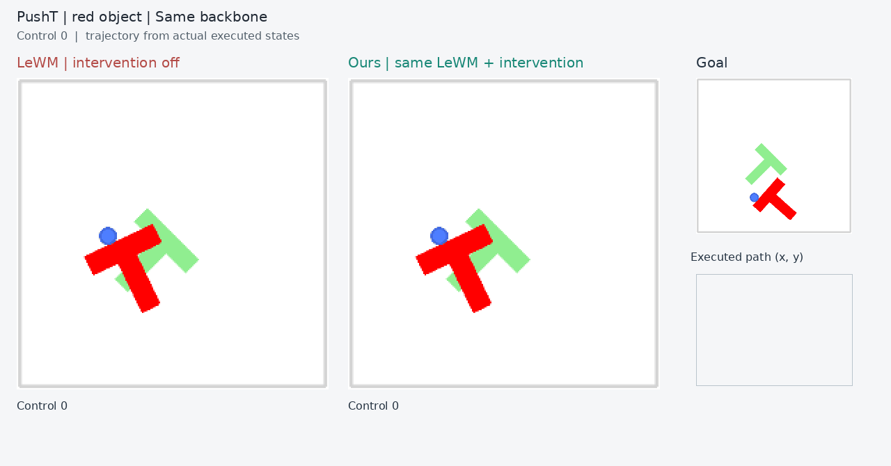
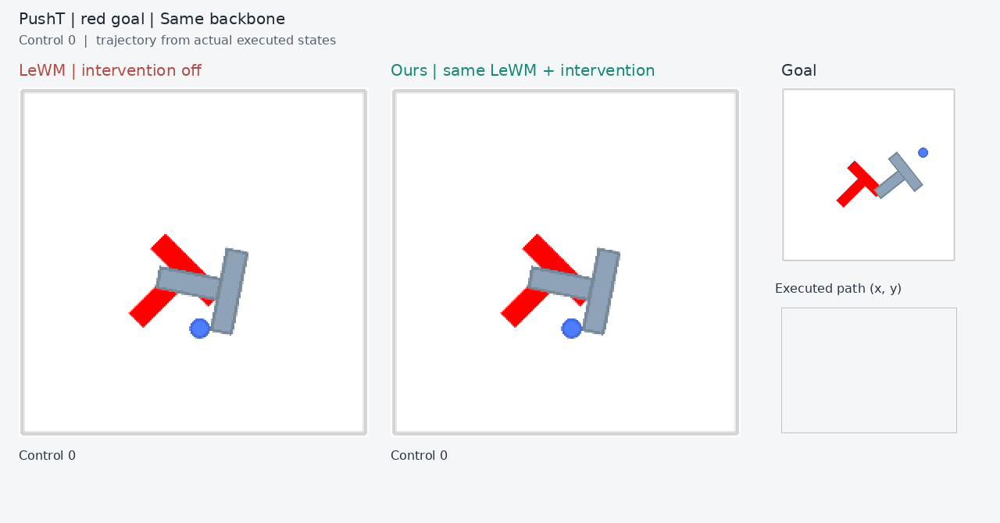

# PushT 颜色变化 · 同 backbone 新增两组

两组均比较同一份冻结 LeWM 模型的干预开关。Ours 完成目标，对比方法在150个控制步预算内未完成，双方 agent 全程完整留在原始画面内。

每组保存新评测的全部真实控制步RGB、原始视频、同步并排MP4、GIF预览及目标图。视频10fps，原始224×224像素保持完整。

## red_object · target 29

Ours 在第 **135** 控制步完成，基线执行150步后未完成。最终联合位置误差 **117.18 → 15.59 px**，角度误差 **23.26° → 12.70°**。

双方agent中心到画面边缘的全程最小距离为 **79.62 px**，agent半径15px。

[并排录像](case_01_red_object_target29/comparison.mp4) · [基线原始视频](case_01_red_object_target29/baseline/execution.mp4) · [Ours原始视频](case_01_red_object_target29/ours/execution.mp4) · [逐帧图片与核验](case_01_red_object_target29)



## red_goal · target 17

Ours 在第 **110** 控制步完成，基线执行150步后未完成。最终联合位置误差 **54.95 → 17.39 px**，角度误差 **64.81° → 3.50°**。

双方agent中心到画面边缘的全程最小距离为 **25.02 px**，agent半径15px。

[并排录像](case_02_red_goal_target17/comparison.mp4) · [基线原始视频](case_02_red_goal_target17/baseline/execution.mp4) · [Ours原始视频](case_02_red_goal_target17/ours/execution.mp4) · [逐帧图片与核验](case_02_red_goal_target17)



## 比较条件与验证

使用同一 LeWM checkpoint，模型张量哈希完全一致，评测期间权重冻结。相同目标、初始状态、seed100、GD100、25个物理控制步规划范围、每次执行5步、150控制步总预算。干预开启前的动作已逐步核验一致。

Ours沿用已存档的LeWM干预实现，包含latent stagnation memory及条件触发的proprio/contact objective，contact项使用观察到的物体位姿和T形几何。具体配置随每个方案附在evidence目录。

成功标准为agent与object联合位置误差<20px且物体角度误差<20°。单独的Goal图是任务目标，场景中的固定彩色T形anchor属于环境背景。原始RGB从本次最终评估执行中保存，按各自首次成功步截断，比较视频会明确标注保持终帧。

在三个颜色条件各50个配对目标中，筛选Ours成功、基线失败且agent中心全程位于[16,496]²的案例，按联合位置与角度误差改善量除以对应成功阈值后的和排序，并优先覆盖不同颜色条件。screening.csv保留全部筛选结果，screening_evidence保留全部数值轨迹和配置。这两组用于定性展示。

`run.py`补跑完整配对评测，`screen.py`验证模型/目标配对、触发前动作、实际终态成功判定与agent可见范围，`package.py`逐像素核验PNG并导出视频。

物理子步复核也已通过。红色物体组agent中心到边缘的全程最小距离为78.38px，红色目标组为23.85px，均大于15px半径。使用保存动作重放后，所有控制步状态与新评测记录完全一致。详见 `physics_visibility.json`。

复现示例（在新输出目录运行）

```bash
CUDA_VISIBLE_DEVICES=0 TORCH_FORCE_NO_WEIGHTS_ONLY_LOAD=1 eval_outputs/rope_local/venv/bin/python media/community_simulations/pusht_same_backbone/run.py --condition red_object --arm native --n-evals 50 --output /tmp/pusht_red_object_native
```

同一颜色条件将 `--arm` 改为 `ours` 并更换输出目录即可运行配对方案。三种颜色条件为 `red_object`、`red_goal`、`red_agent`。
