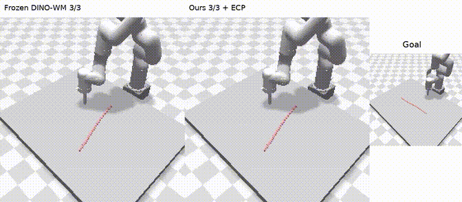
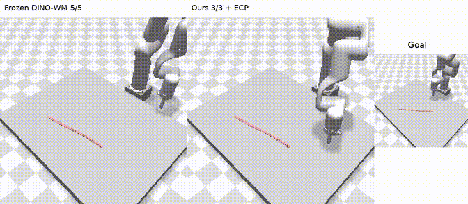
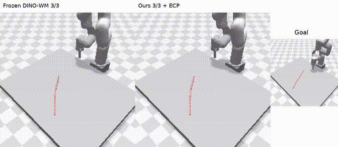

# Rope 每次推动的连续真实仿真录像

三组配对素材覆盖原来的两组和新增的一组。每个方案包含全部已执行推动的独立 MP4、整段录像和逐推 PNG 帧包。

画面由原 PyFleX 仿真器执行保存动作重新录制，覆盖下压、接触推动、抬起及稳定过程。每4个物理步采样一次，仿真步长为1/60秒，MP4以30fps播放，对应约2倍物理速度。PNG帧的准确物理步编号和校验值在同名 JSON 中。

原评测在每个规划块开始恢复记录的粒子位置，本次重放保留该流程。每一推内部连续执行，规划块之间存在原流程的状态恢复与机械臂重置。各方案在原记录结束步停止。

并排视频按播放时间同步，较短一侧保持终帧。逐推对比只覆盖双方均执行的推动编号，所有剩余推动保存在各自目录。

## 原组一 · 同节奏 ECP 消融

重放最终 CD 为 **1.7939 → 0.1677**，降低 **90.7%**。基线共 20 推，Ours 共 20 推。

[并排完整录像](rope_ablation/comparison.mp4) · [GIF 预览](rope_ablation/preview.gif) · [逐推并排录像](rope_ablation/per_push_comparison)

[Frozen 全部推动与原始帧](rope_ablation/baseline) · [Ours 全部推动与原始帧](rope_ablation/ours)

## 原组二 · 完整方法对比

重放最终 CD 为 **0.7163 → 0.0833**，降低 **88.4%**。基线共 20 推，Ours 共 4 推。

[并排完整录像](rope_methods/comparison.mp4) · [GIF 预览](rope_methods/preview.gif) · [逐推并排录像](rope_methods/per_push_comparison)

[Frozen 全部推动与原始帧](rope_methods/baseline) · [Ours 全部推动与原始帧](rope_methods/ours)

## 新增组 · 同节奏 ECP 对比

重放最终 CD 为 **0.8579 → 0.1485**，降低 **82.7%**。基线共 20 推，Ours 共 13 推。

[并排完整录像](rope_additional/comparison.mp4) · [GIF 预览](rope_additional/preview.gif) · [逐推并排录像](rope_additional/per_push_comparison)

[Frozen 全部推动与原始帧](rope_additional/baseline) · [Ours 全部推动与原始帧](rope_additional/ours)

## 方法和来源

原组一使用 seed101 target15，双方3/3节奏，Ours原记录从第7推应用ECP。新增组使用 seed101 target24，双方3/3节奏，Ours原记录从第7推应用ECP。原组二使用 target13，Frozen使用5/5节奏，Ours使用3/3节奏，Ours该例没有触发ECP。

每次推动提供 `push_XX.mp4`、`push_XX_frames.tar.gz` 和 `push_XX.json`。每个方案的 `complete.json` 保留重放CD、原始CD、逐推最大粒子坐标差异、原始记录路径和SHA-256。`source_execution.npz` 保留原动作、粒子状态与目标，`after_push_XX.npy` 保存本次重放的实际粒子状态。

PNG来自直接调用PyFleX渲染接口，没有插值。录制采样不增加物理步，保持原环境的接触/非接触数据采样调用。重放指标按这次真实录制的粒子状态计算。

新增案例从已有20目标、seed100/101的配对记录中筛选，选择Ours成功、实际应用ECP且CD改善明显的另一目标。该选择用于定性视频展示。

`record.py` 负责连续录制，`package.py` 校验每张PNG哈希和采样完整性并输出视频。`validation.json` 汇总三组实际结果，`SHA256SUMS.json` 提供交付文件校验。
