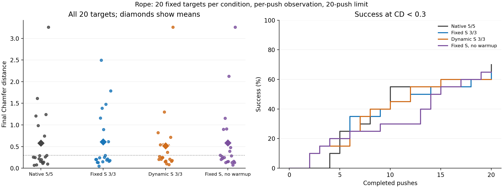

# Rope：四组正式 20 目标实验

每组按原顺序评估 chunk 1、2 的 20 个目标，最多 20 推，每推观测，CD < 0.3 即停。该目标集未参加此前 chunk 0 的 10 样本试跑。

| 条件 | 平均 CD | 成功数 | 实际总推数 | S 触发次数 | 触发样本 | 非饱和强度次数 |
|---|---:|---:|---:|---:|---:|---:|
| native5 | 0.580886 | 14/20 | 255 | 0 | 0 | 0 |
| fixed3 | 0.611238 | 13/20 | 252 | 59 | 9 | 0 |
| dynamic3 | 0.515183 | 12/20 | 250 | 50 | 10 | 2 |
| fixed3_nowarm | 0.583372 | 13/20 | 271 | 67 | 11 | 0 |

有预热的 S 为 5 推，最早影响第 7 推；无预热仍使用三推检测窗口，最早影响第 4 推。固定强度是每条记忆系数 2；动态强度为 2×w。

四组独立执行物理仿真，不复用此前 Native 轨迹。Native-5 与 S-3 的对比同时改变动作块和 S，不能作为 S 的单因素消融。固定/动态及预热对照还须结合实际强度和仿真波动解读。

| 实际动作比较 | 动作序列不同的目标数 | 共有执行推数中动作不同 |
|---|---:|---:|
| native5 → fixed3 | 20/20 | 204/204 |
| fixed3 → dynamic3 | 15/20 | 133/215 |
| fixed3 → fixed3_nowarm | 17/20 | 163/227 |

上述差异来自实际执行控制量；共有部分的差异按反归一化后的物理控制量比较。它们同时受规划节奏、S 和独立仿真分叉影响，不作为 S 的单独因果效果。

[真实仿真截图与每三推序列](visuals/README.md)采用另外两对可视化复跑，未计入本表；图中标注各自复跑的 CD。原正式实验未保存 S 组逐推画面。

全部目标散点与成功曲线：

固定/动态非饱和强度对照是否实际发生：True。若为 False，已触发记忆的动态权重全部饱和为 1，不能把两组成绩差异解释为强度规则的收益。

S 触发计数表示检测器建立记忆的次数，不等于实际使用 S 的规划次数，也不等于成功脱困次数。实际施加 S 的样本、正惩罚候选数见 summary.json；逐样本见 per_sample.csv。

原始指标、动作、配置、模型核验和日志见 evidence.tar.gz，逐文件哈希见 evidence_manifest.json。
