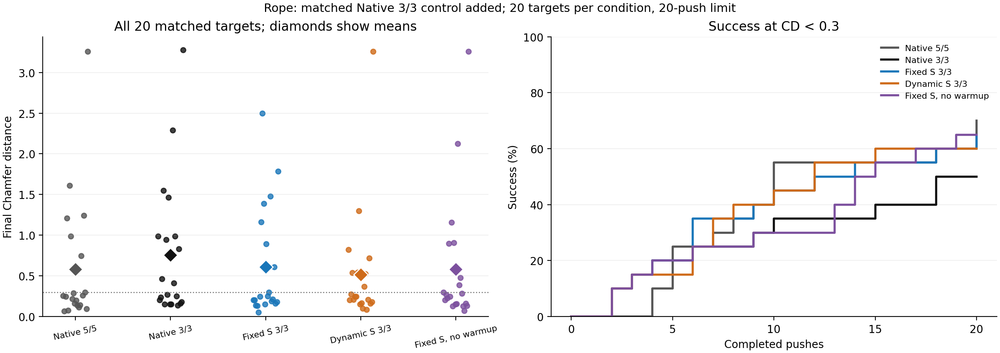

# Rope：补齐同样本 Native 3/3

五组各 20 个相同目标（原编号 10–29），最多 20 推，每推观测，CD < 0.3 即停。原四组结果完整保留，仅新增 Native-3。

| 条件 | 平均 CD↓ | 成功 | 实际总推数 | S 触发次数 | 实际施加 S 的目标 |
|---|---:|---:|---:|---:|---:|
| native5 | 0.580886 | 14/20 | 255 | 0 | 0 |
| native3 | 0.754680 | 10/20 | 287 | 0 | 0 |
| fixed3 | 0.611238 | 13/20 | 252 | 59 | 9 |
| dynamic3 | 0.515183 | 12/20 | 250 | 50 | 9 |
| fixed3_nowarm | 0.583372 | 13/20 | 271 | 67 | 10 |

固定 S 与动态 S 的预热为 5 推；fixed3_nowarm 无额外预热，但仍需三推检测窗口。

## 与 Native-3 的同目标比较

| 条件 | 平均 CD 差（本条件 − Native-3）↓ | CD 更低 / 更高 | 新增成功 / 丢失成功 |
|---|---:|---:|---:|
| native5 | -0.173794 | 10 / 10 | 6 / 2 |
| fixed3 | -0.143442 | 11 / 7 | 5 / 2 |
| dynamic3 | -0.239497 | 10 / 8 | 3 / 1 |
| fixed3_nowarm | -0.171308 | 12 / 6 | 3 / 0 |

Native-5 对 Native-3 比较块长度；Native-3 对三个 S 条件比较同样 3/3 节奏下加入 S 的表现。目标、模型、种子、CEM 候选/迭代、成功规则与预算均匹配。

各条件独立执行物理仿真；相同种子不能消除数值波动。动作在 S 介入前可能已分叉，因此本表是单次独立执行的同协议对照，不能把每一个动作差异都归因于 S。

| 与 Native-3 比较 | 动作序列不同的目标 | 共有推数中动作不同 | S 介入前已有动作差异的目标 |
|---|---:|---:|---:|
| native5 | 20/20 | 223/223 | — |
| fixed3 | 16/20 | 170/237 | 15 |
| dynamic3 | 16/20 | 170/244 | 14 |
| fixed3_nowarm | 17/20 | 205/267 | 14 |

未实际施加 S 而已有动作差异的目标也计入最后一列；逐样本首个动作/CD 差异与首个 S 使用时点见 action_comparisons.csv。

[全部逐样本结果](per_sample.csv) · [动作比较](action_comparisons.csv) · [汇总与校验](summary.json)

原四组和可视化实例见 [原始结果包](../rope_formal20/README.md)。其中的截图来自单独可视化复跑，不混入本表。本次 Native-3 的实际逐推画面全部随补充证据包保存。
