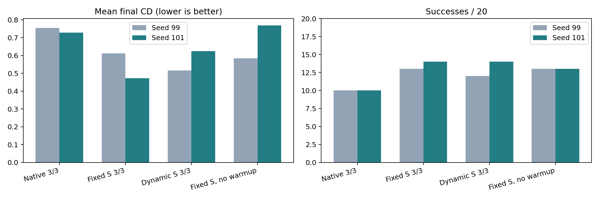

# Rope 3/3：种子 101 的 20 样本复测

四组共用原编号 10–29 的 20 个目标；仅更换基础随机种子。最多 20 推，每推观测，CD <0.3 即停。

| 条件 | 平均 CD↓ | 成功 | S 触发 | 实际施加 S 的样本 | 总推数 |
|---|---:|---:|---:|---:|---:|
| Native 3/3 | 0.7288 | 10/20 | 0 | 0/20 | 239 |
| Fixed S 3/3 | 0.4723 | 14/20 | 48 | 8/20 | 219 |
| Dynamic S 3/3 | 0.6246 | 14/20 | 51 | 8/20 | 214 |
| Fixed S, no warmup | 0.7686 | 13/20 | 74 | 10/20 | 229 |

## 与上一轮种子 99 对照

| 条件 | 99：平均 CD / 成功 | 新种子：平均 CD / 成功 |
|---|---|---|
| Native 3/3 | 0.7547 / 10/20 | 0.7288 / 10/20 |
| Fixed S 3/3 | 0.6112 / 13/20 | 0.4723 / 14/20 |
| Dynamic S 3/3 | 0.5152 / 12/20 | 0.6246 / 14/20 |
| Fixed S, no warmup | 0.5834 / 13/20 | 0.7686 / 13/20 |

## 解释与证据

- 固定 S 和动态 S 均额外预热 5 推；无预热组仍保留 3 推检测窗口。强度分别为 2 和 2×触发严重程度，观测／执行节奏一致。
- 每组独立运行物理仿真，未复用 Native 缓存。相同动作也可能出现物理轨迹差异；动作对照表明确保留干预前的分叉，不能把所有动作变化归因于 S。
- 动态强度是否实际使用了介于 0 与 2 之间的值：True。若为 False，不能据本轮 CD 差异宣称固定／动态强度孰优。
- 这是相同目标的新种子复测，不是新增 20 个未见目标。两轮结果分别保留，不替换旧结果。

[逐样本结果](per_sample.csv) · [逐推 CD](cd_by_push.csv) · [实际动作对照](action_comparisons.csv) · [汇总与核验](summary.json)

[复现说明](../../experiments/rope_seed_repeat/README.md)
