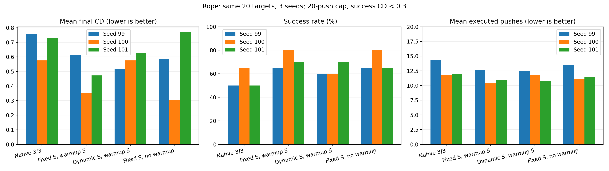

# Rope results across three seeds

Across seeds 99, 100 and 101, **fixed S with five-push warmup improves both final accuracy and execution efficiency over matched Native 3/3**: mean final CD falls **30.2%**, from **0.6865 to 0.4793**, and mean executed pushes fall **10.9%**, from **12.68 to 11.30**. Success rises from **33/60 (55.0%) to 43/60 (71.7%)**, a gain of **16.7 percentage points**. Both CD and mean push count improve in every seed.

All four conditions use the same frozen world model, the same ordered 20 initial/goal pairs (global IDs 10–29), a 3/3 planning/execution cadence with observation after every push, a 20-push cap, and immediate termination at CD <0.3. There are **60 runs per condition and 240 runs total**, comprising 20 targets repeated under three seeds, not 60 distinct targets. Native 5/5 was measured only in the earlier seed-99 study and is not pooled into this matched 3/3 comparison.

## Aggregate results

| Condition, all 3/3 | Mean CD ↓ | CD reduction vs Native | Successes | Success rate | Mean pushes ↓ | Push reduction vs Native | S triggers | Runs applying S |
|---|---:|---:|---:|---:|---:|---:|---:|---:|
| Native | 0.6865 | — | 33/60 | 55.0% | 12.68 | — | 0 | 0/60 |
| Fixed S, warmup 5 | **0.4793** | **30.2%** | **43/60** | **71.7%** | **11.30** | **10.9%** | 146 | 24/60 |
| Dynamic S, warmup 5 | 0.5720 | 16.7% | 38/60 | 63.3% | 11.68 | 7.9% | 152 | 25/60 |
| Fixed S, no extra warmup | 0.5518 | 19.6% | 42/60 | 70.0% | 12.05 | 5.0% | 192 | 28/60 |

Mean pushes include **all runs**, successful and unsuccessful. Unsuccessful runs exhaust the common 20-push budget; successful runs stop at the first CD <0.3 observation. This measures executed-action efficiency under the common stopping rule, not wall-clock speed or pushes averaged only over successful runs. For fixed S with warmup, total executed pushes decrease from **761 to 678**, saving **83 pushes** across 60 runs while solving ten more runs.

## Results by seed

Each entry is **mean CD / successes out of 20 / mean pushes**.

| Condition | Seed 99 | Seed 100 | Seed 101 |
|---|---:|---:|---:|
| Native | 0.7547 / 10 / 14.35 | 0.5759 / 13 / 11.75 | 0.7288 / 10 / 11.95 |
| Fixed S, warmup 5 | 0.6112 / 13 / 12.60 | 0.3542 / 16 / 10.35 | 0.4723 / 14 / 10.95 |
| Dynamic S, warmup 5 | 0.5152 / 12 / 12.50 | 0.5763 / 12 / 11.85 | 0.6246 / 14 / 10.70 |
| Fixed S, no extra warmup | 0.5834 / 13 / 13.55 | 0.3033 / 16 / 11.15 | 0.7686 / 13 / 11.45 |



## Paired outcomes and seed sensitivity

- Fixed S with warmup rescues **12** Native failures and loses **2** Native successes, giving **10 net additional successes**. Final CD is lower in 35 paired runs, higher in 23, and identical in 2. Its success gains across seeds are +3, +3 and +4.
- Dynamic S rescues 8 failures and loses 3 successes. It has the lowest CD in seed 99, but does not improve CD or success in seed 100. Across all three seeds, fixed S with warmup has lower CD and five more successes.
- No-warmup fixed S rescues 10 failures and loses 1 success. It performs best in seed 100, but has worse mean CD than Native in seed 101. The sample SD of the three seed-level mean CDs is **0.2343**, compared with **0.1286** for fixed S with warmup, **0.0548** for dynamic S and **0.0966** for Native. These are descriptive seed-level SDs, not confidence intervals.
- Dynamic S uses an intermediate strength strictly between 0 and 2 in only **6 of 140 actually used trigger memories (4.3%)**. The observed contrast therefore gives limited evidence about the benefits of varying penalty strength.

Fixed S with five-push warmup has the strongest aggregate combination of CD, success and executed pushes in this evaluation. Three seeds over 20 repeated targets establish the observed pattern; they do not establish statistical significance or generalization to a larger target set.

## Executed controls and intervention use

Physical four-dimensional controls are denormalized and compared with matched Native within each seed and target. A push differs when its control L2 difference exceeds 1e-6. Only the prefix actually executed by both methods is compared.

| Condition | Runs with control differences /60 | Different / common executed pushes | Runs whose first difference precedes S or never use S |
|---|---:|---:|---:|
| Fixed S, warmup 5 | 43 | 424/648 | 36 |
| Dynamic S, warmup 5 | 44 | 451/664 | 39 |
| Fixed S, no extra warmup | 46 | 488/692 | 36 |

The simulations execute independently and can diverge before intervention. These action differences cannot all be attributed to S. A detector trigger also need not lead to applied S: the current three-action block is preserved, and success can terminate execution before the next planning block uses its memory. No-extra-warmup still retains the three-push detection window.

## Data and reproduction

- [Aggregate CSV](aggregate.csv), [seed-level CSV](by_seed.csv), [all 240 runs](per_run.csv), and [paired outcome comparisons](paired_comparisons.csv).
- [All action comparisons](action_comparisons.csv), [action summary](action_summary.csv), and [statistics, definitions and source hashes](summary.json).
- [PDF figure](results.pdf).
- Original evidence: [seed 99](../rope_formal20_native3/RESULTS.md), [seed 100](../rope_seed100_20/README.md), [seed 101](../rope_seed101_20/README.md). The original reports include raw evidence archives; seed 99 uses the separate Native-3 archive plus the original formal S runs.

With the original episode directories present under `eval_outputs/rope_formal20_native3`, `eval_outputs/rope_formal20`, `eval_outputs/rope_seed100_20` and `eval_outputs/rope_seed101_20`, run from the repository root using Python with NumPy and Matplotlib:

```bash
python experiments/rope_seed_repeat/aggregate_three_seeds.py
```

The script reads all 240 episode outputs, checks model/target identity, verifies the stopping rule and executed-action lengths, and recomputes every seed's CD, success, trigger/application and push totals against its original summary. It writes the CSV/JSON outputs and figures without rerunning physics or planning.
